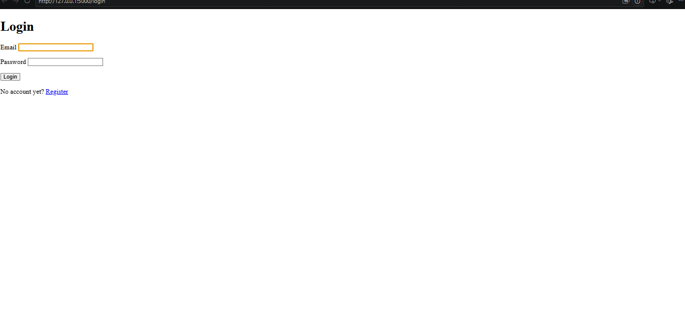

# Lab 2: Login & To-Do Application

## 1. Team
| Name | ID | Who did what |
|---|---|---|
| Eyad Eshba | 2304113 | startup (database, back end, README) |
| EzzEldeen Gamal | 2304043 | Save and delete and edit and frontend |

## 2. Technology
- **Back end:** Python 3.12, Flask, PyMySQL (plain SQL, no ORM), bcrypt, python-dotenv
- **Front end:** HTML (Jinja templates), CSS, plain JavaScript
- **Database:** MySQL, database `registration`

## 3. How to run it (from an empty machine)
1. Install **Python 3.12**, **MySQL Server** and **Git**.
2. Get the code:
   ```
   git clone <repository-url>
   cd db-lab2-eyad
   ```
3. Create the virtual environment and install the libraries:
   ```
   python -m venv venv
   venv\Scripts\activate          (macOS/Linux: source venv/bin/activate)
   pip install -r requirements.txt
   ```
4. Create the database (this re-runs safely, it starts with `DROP DATABASE IF EXISTS`):
   ```
   mysql -u root -p < database/schema.sql
   ```
   (In PowerShell use `Get-Content database\schema.sql | mysql -u root -p`, or open the file in MySQL Workbench and run it.)
5. Copy `.env.example` to `.env` and put your MySQL password and a random `SECRET_KEY`.
6. Start the server:
   ```
   python app.py
   ```
7. Open <http://127.0.0.1:5000>.

## 4. Features
- **R1** Register (name, e-mail, password, confirm), `Email Already Exists`, automatic login, then the list
- **R2** Login with the same `Invalid email or password` for a wrong e-mail and a wrong password; Logout
- **R3** Private list: not logged in -> login page; each user sees only their own to-dos, newest first
- **R4-R7** Add, edit, mark done / not done, delete (with an "are you sure?" question)
- **R8** Validation in the browser (JavaScript) and again on the server, with the exact messages
- **R9** bcrypt hashes, only the given queries, always with `%s` parameters, `user_id` taken from the session
- **R10** One consistent blue/black style, responsive (works at 360 px), clear error messages, a visible state for done to-dos, a friendly empty state, name + Log out button, styled error pages (no stack traces)

## 5. Screenshots
Put the images in `screenshots/` and keep these names:
1. `register-errors.png` - register page with error messages
2. `login.png` - login page
3. `list.png` - list with some to-dos (one done)
4. `phone.png` - the site in a phone-sized window





## 6. Answers
**(a) Why do UPDATE and DELETE contain `AND user_id = ?`, and what changes if you remove it?**
The id of a to-do comes from the browser, so anybody can send somebody else's number. With `AND user_id = ?` (the id of the logged-in user, taken from the session) the statement changes zero rows when the to-do is not yours. Without it, any logged-in user could edit, mark or delete other users' to-dos just by changing the number in the request.

**(b) What happens if you insert a to-do for a `user_id` that does not exist, and which constraint is that?**
MySQL refuses the insert with error 1452 ("a foreign key constraint fails"). It is the **foreign key (referential integrity) constraint**: every value of `todos.user_id` must exist in `users.user_id`.

**(c) Why do you store a hash and not the password?**
If the database leaks, the passwords are not exposed. A hash cannot be reversed, and bcrypt is salted (equal passwords give different hashes) and slow on purpose, which makes guessing attacks expensive. To log in, the library compares the typed password with the stored hash.

**(d) `name` is NOT NULL: why do you still need your own check for an empty name?**
`NOT NULL` only forbids the value NULL. An empty text `''` is a value, so MySQL accepts it. Only our own check (browser and server) can refuse an empty name.
